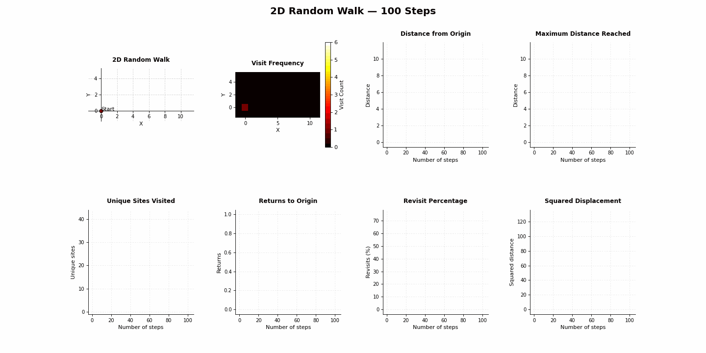

# 2D Random Walk Simulation

An animated exploration of random motion on a two-dimensional grid, built with Python, NumPy, and Matplotlib. Follow a walker step by step while a synchronized heatmap and statistical plots reveal how it explores, revisits locations, and moves away from its starting point.

## Preview



<!-- Replace the GIF filename above with your actual filename in Gifs. Paths are case-sensitive. -->

## How it works

The walker starts at **(0, 0)**. At each step, it independently chooses one of four equally likely directions: right, left, up, or down. Each move has length 1.

The dashboard contains eight plots:

| Plot | What it shows |
| --- | --- |
| Random walk | The path, current position, and start/end markers |
| Visit-frequency heatmap | The number of visits to each grid location |
| Distance from origin | Euclidean distance from the starting point at each step |
| Maximum distance reached | The largest distance reached up to each step |
| Unique sites visited | The cumulative number of distinct locations visited |
| Returns to origin | The cumulative return count, excluding the initial position |
| Revisit percentage | The percentage of completed steps landing on previously visited sites |
| Squared displacement | The squared distance from the origin at each step |

## Run locally

Install the dependencies:

```bash
python -m pip install numpy matplotlib
```

Run the simulation from the repository directory:

```bash
python 2D_Random_Walk.py
```

Python's `random` module is part of the standard library.

## Customize the simulation

Change the step count in the script:

```python
n = 1000
```

Rerun the script to generate a new walk. Unless a random seed is set, each run produces a different path.

The animation's `interval` controls the delay between displayed frames in milliseconds. For example, `interval=100` targets 10 frames per second during playback.

## The mathematics

After step $t$, the distance from the origin is

$$
r_t = \sqrt{x_t^2 + y_t^2}.
$$

The squared displacement is $r_t^2 = x_t^2 + y_t^2$. For independent, equally likely unit steps,

$$
\mathbb{E}[r_t^2] = t.
$$

This is an expectation across independent walks. A single trajectory can fluctuate substantially and does not need to follow the line $r_t^2=t$. The corresponding theoretical root-mean-square distance is $\sqrt{t}$.

If $U_t$ is the number of unique sites visited, including the starting point, the revisit percentage after $t>0$ steps is

$$
100\,\frac{t+1-U_t}{t}.
$$

At step zero, the plotted revisit percentage is set to zero by convention.

## Built with

- **Python** — simulation logic
- **NumPy** — numerical calculations
- **Matplotlib** — plots and animation